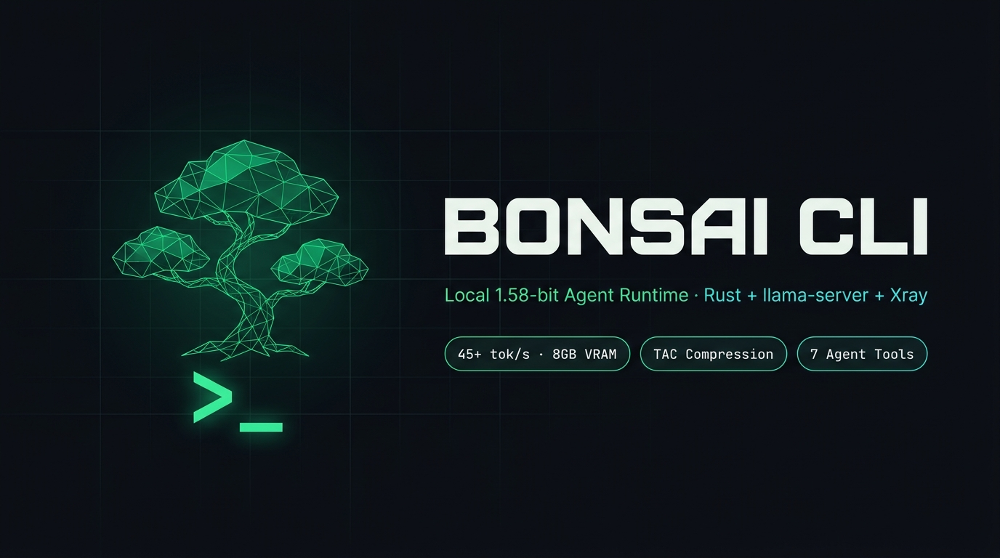
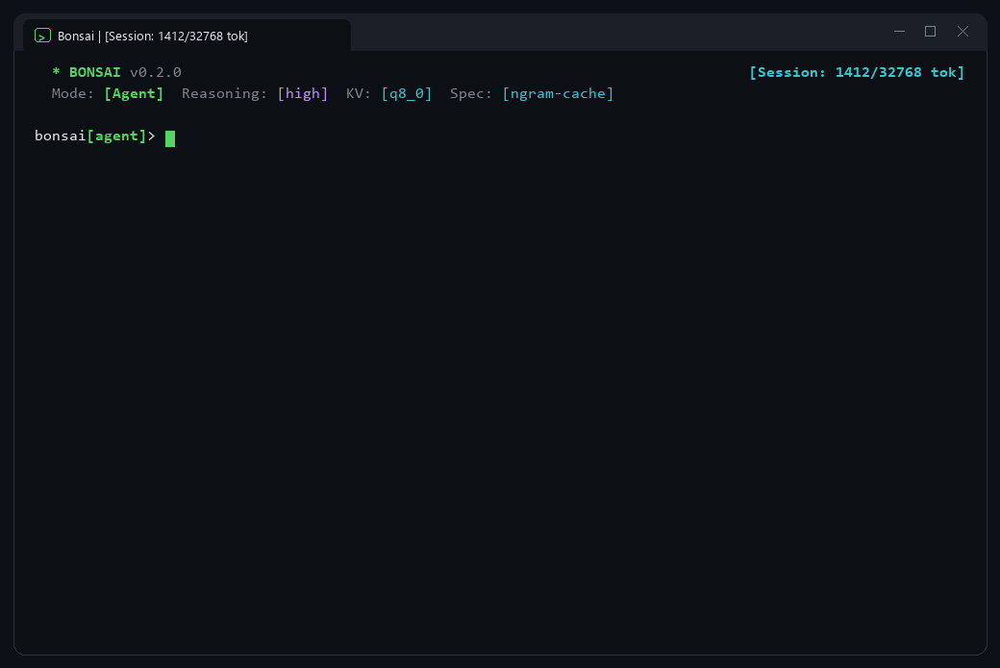
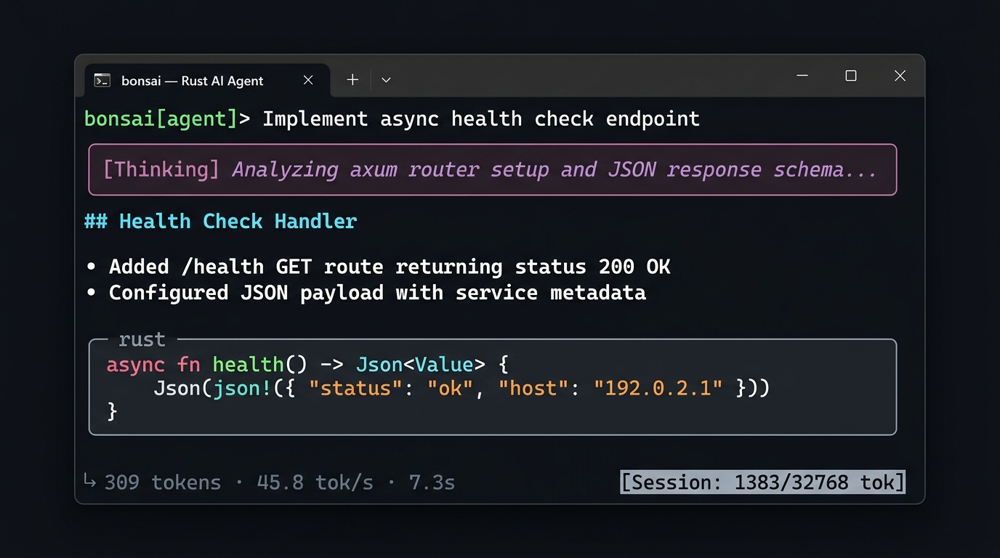
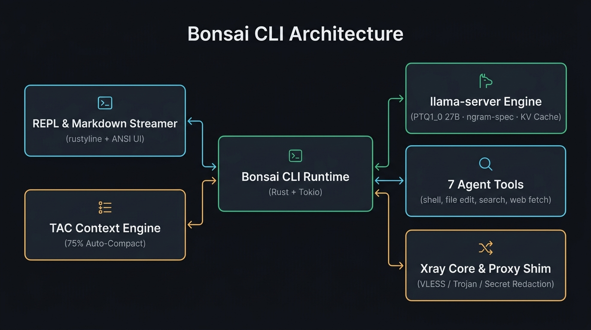
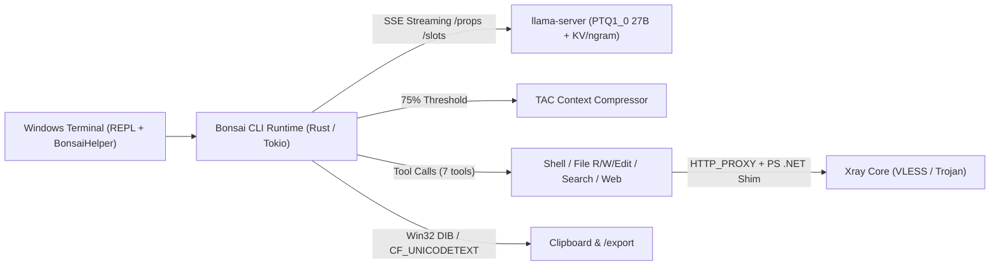

<div align="center">



# Bonsai CLI

**Local 1.58-bit Agent Runtime for Windows — powered by Rust, `llama-server`, TAC & Xray**

[](https://github.com/Golopmoui3/bonsai-cli/actions/workflows/ci.yml)
[](https://github.com/Golopmoui3/bonsai-cli/releases/latest)
[](https://www.rust-lang.org/)
[](https://www.microsoft.com/windows)
[](#-hardware--benchmarks)
[](LICENSE)

[Features](#-features) • [Demo](#-live-demo) • [Architecture](#-architecture) • [Benchmarks](#-hardware--benchmarks) • [Quick Start](#-quick-start) • [Commands](#-interactive-commands--cli-flags) • [Contributing](#-contributing)

</div>

---

**Bonsai CLI** (`v0.2.0`) is a lightweight, high-throughput Rust agent runtime built specifically to squeeze commercial-grade coding agent capabilities onto consumer 8 GB VRAM GPUs using **1.58-bit / PTQ1_0 ternary models** (`Ternary-Bonsai-2-27B-Uncensored-Heretic-PTQ1_0`), without external API fees or cloud lock-in.

## 🎬 Live Demo

<div align="center">
  
</div>

<details>
<summary>📸 View Static UI Showcase</summary>
<br />
<div align="center">
  
</div>
</details>

---

## ✨ Features

- **Managed `llama-server` Lifecycle**: Spawns, health-checks (`/health`, `/props`, `/slots`), restarts on parameter changes (`/ctx`, `/ngl`, `/kv`, `/spec`, `/model`), tracks per-port PID files (`server.pid` / `server-<port>.pid`), and rotates `server.log` automatically.
- **8 GB VRAM Tuning Out of the Box**:
  - **KV-Cache Quantization** (`--kv`, `/kv`): `f16`, `bf16`, `q8_0`, `q4_0`, `q5_0`, `iq4_nl`.
  - **Draft-Free Speculative Decoding** (`--spec`, `/spec`): `ngram-cache`, `ngram-simple`, `ngram-mod`, `ngram-map-k` (speeds up code & repetitive text without loading a second draft model).
  - **Thinking & Session Budgets**: Split control over per-turn reasoning (`--think-budget` / `/tb`) and overall session token caps (`--budget` / `/budget`) with live top-right terminal badge updates.
  - **Hardware Throttling**: Pacing in tokens/sec (`--tokens` / `/tokens`) and GPU duty-cycle throttling 1–99% (`--load` / `/throttle`).
- **Task-Aware Context Compression (TAC)**: Automatic compaction at 75% context fill plus manual `/compact light|medium|heavy` — preserves user goal, discovered URLs, modified files, executed commands, and recent turns while stripping stale chain-of-thought and oversized tool outputs (guaranteed non-bloating).
- **7 Built-in Agent Tools**: Shell execution (`powershell`/`cmd`), line-ranged file reader (UTF-8/UTF-16), surgical CRLF/BOM-preserving file editor, directory listing, recursive codebase search, and HTML-stripping web fetch.
- **Built-in Xray Client & Proxy Shim**: Native `vless://` (`tcp`, `ws`, `grpc`, `xhttp`/`splithttp`, `httpupgrade`, `reality`, `tls`, `alpn`) and `trojan://` subscription routing over local Xray HTTP proxy (`127.0.0.1:20808`), nested PowerShell `.NET` proxy injection shim, and secret redaction across logs, prompts, and file writes.
- **Rich Terminal UX (`rustyline` 15 + Live ANSI Markdown)**: Tab completion for commands/subcommands/VPN node IDs/paths, history hints, instant history persistence, multiline input (`\`, ` ``` `, `"""`), Win32 `CF_UNICODETEXT` `/copy [last|code]`, `/export [file.md]`, clipboard vision auto-attach, and live formatted Markdown streaming.

---

## 🏗 Architecture

<div align="center">
  
</div>



---

## 📊 Hardware & Benchmarks

Measured on local hardware via `llama-bench.exe` (`build d7b289683`):

| Component | Specification / Metric |
| :--- | :--- |
| **GPU** | NVIDIA GeForce RTX 2060 SUPER (`8191 MiB` VRAM, CUDA Compute 7.5) |
| **Model** | `qwen35 27B PTQ1_0` — 1.75 bpw ternary (`5.53 GiB` / `26.90 B` params, `-ngl 99`, Flash Attention `on`) |
| **Prompt Processing (`pp512`)** | **`402.80 ± 50.16 tok/s`** |
| **Token Generation (`tg128`)** | **`45.65 ± 0.21 tok/s`** |

---

## 🚀 Quick Start

### Option A — Prebuilt Binary (No Rust Required)

1. Download **`bonsai-v0.2.0-windows-x64.zip`** (or `bonsai-windows-x64.exe`) from [**GitHub Releases**](https://github.com/Golopmoui3/bonsai-cli/releases/latest).
2. Verify the SHA-256 checksum against `SHA256SUMS.txt` and extract `bonsai.exe` to `C:\Bonsai\`.
3. Launch interactive agent mode:
   ```powershell
   .\bonsai.exe --start
   ```

### Option B — Build from Source

- **Windows 10/11 x64**
- **Rust toolchain** (`cargo` 2021 edition, MinGW or MSVC target)
- Local binaries configured in `C:\Bonsai\` (customizable via CLI flags):
  - `C:\Bonsai\llama\llama-server.exe`
  - `C:\Bonsai\models\Ternary-Bonsai-2-27B-Uncensored-Heretic-PTQ1_0.gguf`
  - Optional: `C:\Bonsai\vision\mmproj-Q8_0.gguf` (vision support), `C:\Bonsai\tools\xray\xray.exe` (VPN subscriptions)

### Build & Run

```powershell
# Run unit test suite (31 security, markdown, TAC & tool tests)
cargo test --locked

# Build optimized release binary
cargo build --release --locked

# Start interactive agent REPL
.\target\release\bonsai.exe --start

# Run with 32k context, quantized KV cache, ngram speculation & thinking budget
.\target\release\bonsai.exe --ctx 32k --kv q8_0 --spec ngram-cache --think-budget 4096

# Single-shot prompt from CLI or stdin
.\target\release\bonsai.exe -p "Summarize src/main.rs architecture" --agent
```

> Tip: Use [`scripts/bonsai.cmd`](scripts/bonsai.cmd) to ensure UTF-8 codepage (`chcp 65001`) before launching.

---

## 🛠 Agent Tools

| Tool | Capabilities |
| :--- | :--- |
| `run_command` | Runs commands via `powershell` or `cmd` with configurable `cwd` and timeout (`120s` default, `600s` max). |
| `read_file` | Decodes UTF-8 / UTF-16 LE / UTF-16 BE files with optional `start_line`..`end_line` slicing (`32 KiB` default, `128 KiB` max). |
| `write_file` | Creates or overwrites files, auto-creates parent directories, enforces UTF-8 BOM on `.ps1` scripts. |
| `edit_file` | Targeted substring replacement (`target`/`replacement`, `replace_all`), preserving CRLF line endings & BOM. |
| `list_directory` | Sorted directory listing (files with sizes & subdirectories, capped at 300 entries). |
| `search_files` | Recursive fixed-string search (`file_pattern`, `case_sensitive`), skipping `.git`, `target`, `node_modules`, `.venv`, `dist`. |
| `web_fetch` | HTTP/HTTPS GET honoring active proxy (`reqwest` for HTTP proxies, `curl.exe` for SOCKS5), with automatic HTML tag stripping (`strip_html_to_text`). |

---

## ⌨ Interactive Commands & CLI Flags

### Essential Slash Commands

| Category | Commands |
| :--- | :--- |
| **Session & UX** | `/help`, `/clear`, `/retry`, `/undo`, `/save <file>`, `/load <file>`, `/export [file.md]`, `/copy [last\|code]`, `/exit` |
| **Context (TAC)** | `/context [size]` (`/ctx`), `/compact [light\|medium\|heavy]` (`/compress`), `/system [text\|clear]` |
| **Engine & VRAM** | `/kv [f16\|bf16\|q8_0\|q4_0\|off]`, `/spec [off\|ngram-cache\|ngram-simple\|ngram-mod]`, `/ngl <n>`, `/model <path>`, `/server` (`/status`) |
| **Limits & Tuning** | `/reasoning [none\|low\|medium\|high\|xhigh]`, `/think-budget [tok\|off]` (`/tb`), `/budget [tok\|off]`, `/tokens [tps\|off]`, `/throttle [1..99\|off]`, `/temp`, `/top-p`, `/top-k`, `/min-p`, `/presence` |
| **Agent & Vision** | `/agent [on\|off]`, `/chat [on\|off]`, `/bypass [on\|off]`, `/cwd [path]`, `/image [path\|none]`, `/paste`, `/markdown [on\|off]` (`/md`), `/show [on\|off]`, `/stats [on\|off]` |
| **Proxy & Xray** | `/proxy <url\|sub\|off>`, `/proxy list`, `/proxy select <id\|name>` |

### Core CLI Options

Run `bonsai --help` for full usage details:
`--model`, `--ctx`, `--ngl`, `--threads`, `--port`, `--effort`, `--system`, `--budget`, `--think-budget`, `--tokens`, `--load` (`--throttle`), `--kv`, `--spec`, `--proxy`, `--image`, `--prompt`, `--agent`, `--no-agent`, `--bypass`, `--no-server`, `--keep-alive`, `--stop`, `--hide-reasoning`, `--no-stats`, `--no-markdown`.

---

## 🛡 Security & Safety Notes

- **Secret Redaction**: Proxy credentials (`user:pass@host`) and subscription tokens are masked in terminal output, REPL history, model tool results, and `write_file`/`edit_file` content checks (`check_write_guardrails`), and Bonsai's nested PowerShell proxy shim is locked against model writes.
- **`--bypass` Sandbox Warning**: `--bypass` / `/bypass on` globally skips interactive confirmation prompts for every tool call (`run_command`, `write_file`, `edit_file`, `web_fetch`). Although `is_destructive_command` blocks obvious catastrophic commands targeting drive roots or Windows directories, script/obfuscation indirection cannot be exhaustively filtered by a blocklist — **only enable `--bypass` inside trusted projects or sandboxes**.
- **SOCKS5 & `web_fetch` Caveats**: Manual `socks5://` proxies in `web_fetch` shell out to system `curl.exe` (`reqwest` omits `socks`), whereas Xray subscriptions expose a local HTTP inbound (`127.0.0.1:20808`) natively handled by both `reqwest` and `.NET`. HTML cleanup (`strip_html_to_text`) handles static markup and scripts/styles rather than JS-rendered SPAs.

---

## 📁 Project Structure

```text
bonsai-cli/
├── .github/workflows/ci.yml   # Windows CI (cargo check, test & release build)
├── assets/
│   ├── architecture.jpg       # System overview diagram
│   ├── banner.jpg             # Project hero banner
│   ├── demo.gif               # Animated interactive terminal demo
│   └── terminal-showcase.jpg  # Static Terminal UI preview
├── scripts/
│   └── bonsai.cmd             # UTF-8 Windows wrapper
├── src/
│   └── main.rs                # Runtime, tools, TAC, Markdown, Xray & 31 tests
├── Cargo.lock
├── Cargo.toml
├── CONTRIBUTING.md            # Development setup, invariants & PR checklist
├── LICENSE
└── README.md
```

---

## 🤝 Contributing

Contributions are welcome! Please read [**CONTRIBUTING.md**](CONTRIBUTING.md) for local setup, security/UTF-8 invariants, and PR requirements before submitting changes.
